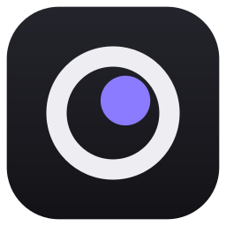

# observex



A Windows desktop app that reads the screen like a human, only much faster. It captures the screen as many times per
second as possible, recognises things like shapes, UI elements and buttons in real time, and reacts with mouse and
keyboard input. The end goal is an app that learns to play a game by watching, saves what it learned, and loads that
knowledge later to play on its own.

Speed comes first: the highest capture rate and the lowest reaction latency possible.

C++20, Direct3D 11, DXGI Desktop Duplication, [Dear ImGui](https://github.com/ocornut/imgui) (docking branch).

## Status

Screen capture works; recognising and reacting are next.

- **Screen button**: shows which screen observex is watching ("Observing Odyssey G61SH") and opens live miniatures
  of every screen, arranged as on your desktop and labelled with each monitor's name. Click one and observex watches
  it; the window shows that screen live. F3 shows the capture numbers.
- **Capture**: every new image of the observed screen, kept on the GPU. On a 240 Hz monitor it captures every refresh
  (about 240 images per second) and has the image 0.05 ms after the screen updates, with about 0.1 ms of CPU work
  per image.
- The capture loop runs on its own top-priority thread with its own GPU device, so the UI can never slow it down.
  It reconnects by itself after fullscreen switches, UAC prompts and the lock screen.

## Build (Windows)

Needs Visual Studio 2022 with the "Desktop development with C++" workload, and CMake 3.25 or newer.
The first configure downloads Dear ImGui, doctest and the Inter font (pinned versions, checked by SHA256).

```bash
cmake --preset vs2022
```

```bash
cmake --build --preset release
```

```bash
ctest --preset release
```

```bash
./observex.exe
```

The Release build writes `observex.exe` straight into the project folder. Use `--preset debug` for a debug build
(in `build/vs2022/bin/Debug/`); it keeps a console window and uses the Direct3D debug layer when installed.
You can also open the folder in Visual Studio (it reads `CMakePresets.json`), or open `build/vs2022/observex.sln`
after configuring.

## Benchmark

`observex_bench` measures the capture pipeline from a console, without opening the app window:

```bash
build/vs2022/bin/Release/observex_bench.exe --seconds 5
```

It lists the screens, captures one (`--screen N`, the primary by default) and prints images per second, merged
updates, latency and work per image once a second. To give capture something to do, it presents an invisible 2 x 2
pixel window in the screen's corner every refresh, like a game would (`--no-pulse` turns that off). `--no-preview`
leaves out the copy the UI makes to show the screen.

## UI snapshots

To check how the UI looks without the window appearing or taking focus, snapshot mode draws it in a hidden window,
plays some clicks, and saves a PNG:

```bash
./observex.exe --snapshot ui.png --click 1020 540 --click 120 33 --mouse 300 200
```

Each `--click X Y` (window pixels) happens about 0.6 s after the one before, and `--mouse X Y` is where the mouse
rests for the picture. The snapshot shows your real screens.

## Layout

| Path | What it holds |
| --- | --- |
| `src/core/` | Platform-free building blocks: lock-free hand-over, statistics. Unit tested. |
| `src/engine/` | The real-time pipeline: GPU setup, screen capture, preview hand-over to the UI. No UI code. |
| `src/app/` | The window and UI: main window, theme, screen picker, screen view, UI snapshots. |
| `bench/` | The headless capture benchmark. |
| `assets/` | Logo and app icon, made by `tools/make_logo.py`. |
| `tests/` | doctest unit tests for `src/core`. |
| `docs/` | Longer plans, such as [the training loop](docs/training-loop.md). |
| `cmake/Dependencies.cmake` | Third-party libraries and their pinned versions. |

## Next steps

- Learn to recognise: record play, review what observex found, train, repeat. First target: monsters in
  Lineage 2. The plan is in [docs/training-loop.md](docs/training-loop.md).
- Recognise live: run the trained detector on every captured image on the GPU, reading back only the results.
- React: press keys and click the mouse in response.
- Knowledge: save what observex learned (what to look for, how to react) and load it on start.

## Credits

The UI font is [Inter](https://rsms.me/inter/) by Rasmus Andersson, under the SIL Open Font License 1.1.
